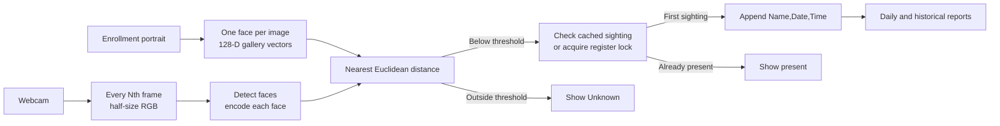

# iDetectFace

A local webcam attendance system for a supervised lab or workshop. An organizer enrolls a participant with one portrait. When the camera recognizes them, the register keeps the timestamp of their first accepted sighting that day. Reappearing later leaves the original check-in time intact.

**Python 3.11 · OpenCV · dlib · NumPy · local CSV**

Try the [live photo check-in](https://idetectface.streamlit.app/) in English or বাংলা. Give it one photo of yourself and a second photo to check in, then download your attendance. To host your own copy, follow the [free Streamlit deployment guide](demo/README.md).

## Follow a check-in



The camera processes every second frame by default and reuses the last boxes between observations. The number beside a face is its embedding distance. Smaller values indicate a closer match. The default acceptance rule is `distance < 0.5`. [Recognition API](https://face-recognition.readthedocs.io/en/latest/face_recognition.html)

## Run it locally

1. Clone the repository and create a virtual environment with **64-bit CPython 3.11**. Use `py -3.11` on Windows or `python3.11` on Linux and macOS for the environment creation command. The full CI matrix covers Windows and Ubuntu.

   ```sh
   git clone https://github.com/pial-paul/iDetectFace.git
   cd iDetectFace
   python3.11 -m venv .venv
   ```

2. Activate with `.\.venv\Scripts\Activate.ps1` in PowerShell or `source .venv/bin/activate` in a POSIX shell. Install the hash-locked runtime, then the application.

   ```sh
   python -m pip install --upgrade pip
   python -m pip install --require-hashes -r requirements.txt
   python -m pip install --no-deps .
   python -m pip check
   ```

   The desktop OpenCV and community-built dlib wheels provide the native libraries. Use one OpenCV wheel per environment. Models download at installation time and recognition runs locally. [dlib wheel build project](https://github.com/alesanfra/dlib-wheels) · [OpenCV wheel selection](https://pypi.org/project/opencv-python/)

3. Start the menu with `idetectface --data-dir .local-data`. Choose **2** to enroll a consenting participant under a unique ID such as `demo-01`. With exactly one face in view, press **Space** to save or **Esc** to cancel. Choose **1** to start attendance and press **q** in the preview to finish. Choose **3** to view today, a specific day, or all days.

The original `python opencv_attendance.py` menu still uses `known_faces/` and `attendance.csv` in the current directory. Point `--data-dir` at an existing register to use its original `Name,Date,Time` rows and JPG, JPEG or PNG enrollment files. New registers create the CSV on the first check-in.

### Run individual operations

```sh
python opencv_attendance.py --data-dir .local-data enroll demo-01
python opencv_attendance.py --data-dir .local-data --camera 0 --every 2 --threshold 0.5 run
python opencv_attendance.py --data-dir .local-data records
python opencv_attendance.py --data-dir .local-data records --date 2025-03-09
python opencv_attendance.py --data-dir .local-data records --all
```

## What the benchmark shows


On one Windows machine, a repeat of the last recorded identity in a 10,000-row synthetic log took **17.7 µs** per check, compared with **4,448.7 µs** for a match at the end of the original sequential scan. The fast path checks that the register and local date still match the cached sighting. Camera inference, alternating identities and first writes fall outside this measurement. [Method, exact values and reproduction steps](docs/evaluation.md)

```sh
python -m unittest discover -s tests -v
python -m benchmarks.duplicate_lookup
```

Both commands run without a webcam or personal images. The tests exercise midnight rollover, competing writers, enrollment collisions, the matching threshold, unknown faces and camera failures. The evaluation guide also includes a command for scoring held-out portraits.

## Use in a supervised pilot

Use unique participant IDs to distinguish people with the same name. Offer a manual check-in and let an organizer correct missed or mistaken entries. A photograph can trigger a match. Classroom accuracy, liveness and demographic performance have yet to be validated. Recognition quality depends on capture conditions and the enrolled population.

Portraits and the CSV are ordinary local files. Restrict access to the data directory and agree on a deletion date with participants. Publish aggregate results and synthetic examples. Earlier Git revisions include demonstration portraits and attendance rows. [Engineering decisions and operating limits](docs/engineering.md)

## Project guide

- [Engineering review](docs/engineering.md) covers the original defects, design changes, failure handling and next implementation priorities.
- [Evaluation protocol](docs/evaluation.md) covers storage latency, recognition errors and a physical-camera acceptance check.
- [Portfolio descriptions](docs/portfolio.md) contains résumé bullets for software engineering and research applications.

- [Security and private data](SECURITY.md) describes the local trust boundary and how to report an issue.
- [Contributor guide](CONTRIBUTING.md) includes packaging, lint, tests and dependency auditing.

Project code is distributed under the [MIT License](LICENSE). Model files and dependencies retain their upstream terms. [Model provenance](https://pypi.org/project/face-recognition-models/)
