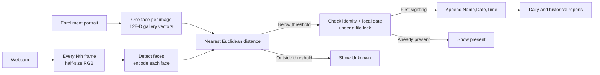
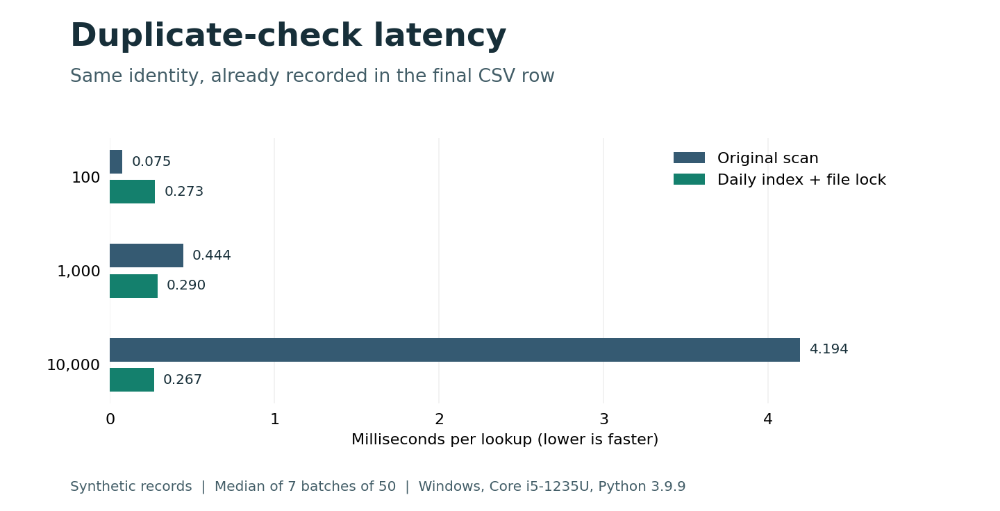

# iDetectFace

A local webcam attendance system for a supervised lab or workshop. An organizer enrolls a participant with one portrait. When the camera recognizes them, the register keeps the timestamp of their first accepted sighting that day. Reappearing later leaves the original check-in time intact.

**Python · OpenCV · dlib · face_recognition · NumPy**

## Follow a check-in



The camera processes every second frame by default and reuses the last boxes between observations. The number beside a face is its embedding distance. Smaller values indicate a closer match. The default acceptance rule is `distance < 0.5`. [Recognition API](https://face-recognition.readthedocs.io/en/latest/face_recognition.html)

## Run it locally

1. Open a terminal in the project checkout. Create a virtual environment with a 64-bit Python interpreter. The clean Windows installation below was verified with Python 3.9.9. The CI workflow targets Python 3.11.

   ```sh
   python -m venv .venv
   ```

2. Activate it with `.\.venv\Scripts\Activate.ps1` in PowerShell or `source .venv/bin/activate` on Linux and macOS. Install the desktop dependencies.

   ```sh
   python -m pip install --upgrade pip
   python -m pip install -r requirements.txt
   python -m pip check
   ```

   If pip needs to build dlib, install CMake and a C++ compiler first. On Windows, use Visual Studio Build Tools with the **Desktop development with C++** workload. Use one OpenCV wheel per environment. A headless wheel omits the preview windows. [dlib build instructions](https://dlib.net/compile.html) · [OpenCV wheel selection](https://pypi.org/project/opencv-python/)

3. Start a private demo register. Choose **2** to enroll a consenting participant under a unique ID such as `demo-01`. With exactly one face in view, press **Space** to save or **Esc** to cancel. Choose **1** to start attendance and press **q** in the preview to finish. Choose **3** to view today, a specific day, or all days.

   ```sh
   python opencv_attendance.py --data-dir .local-data
   ```

The original `python opencv_attendance.py` menu still uses `known_faces/` and `attendance.csv` in the current directory. Point `--data-dir` at an existing register to use its original `Name,Date,Time` rows and JPG, JPEG or PNG enrollment files. New registers create the CSV on the first check-in.

### Run individual operations

```sh
python opencv_attendance.py --data-dir .local-data enroll demo-01
python opencv_attendance.py --data-dir .local-data --camera 0 --every 2 --threshold 0.5 run
python opencv_attendance.py --data-dir .local-data records
python opencv_attendance.py --data-dir .local-data records --date 2025-03-09
python opencv_attendance.py --data-dir .local-data records --all
```

## What the benchmark shows



At 10,000 synthetic rows, median time per repeated check fell from **4.194 ms to 0.267 ms** on one Windows laptop. At 100 rows, the file lock made the indexed path slower. The benchmark isolates a warm lookup with a match in the last row. Camera capture, detection and first-time writes are outside the timing. [Method, exact values and reproduction steps](docs/evaluation.md)

```sh
python -m unittest discover -s tests -v
python -m benchmarks.duplicate_lookup
```

Both commands run without a webcam or personal images. The tests exercise midnight rollover, competing writers, enrollment collisions, the matching threshold, unknown faces and camera failures. The evaluation guide also includes a command for scoring held-out portraits.

## Use in a supervised pilot

Use unique participant IDs to distinguish people with the same name. Offer a manual check-in and let an organizer correct missed or mistaken entries. A photograph can trigger a match. Classroom accuracy, liveness and demographic performance have yet to be validated. Recognition quality depends on capture conditions and the enrolled population.

Portraits and the CSV are ordinary local files. Restrict access to the data directory and agree on a deletion date with participants. Publish aggregate results and synthetic examples. Earlier Git revisions include demonstration portraits and attendance rows. [Engineering decisions and operating limits](docs/engineering.md)

## Project guide

- [Engineering review](docs/engineering.md) covers the original defects, design changes, failure handling and next implementation priorities.
- [Evaluation protocol](docs/evaluation.md) covers storage latency, recognition errors and a physical-camera acceptance check.
- [Portfolio descriptions](docs/portfolio.md) contains résumé bullets for software engineering and research applications.
