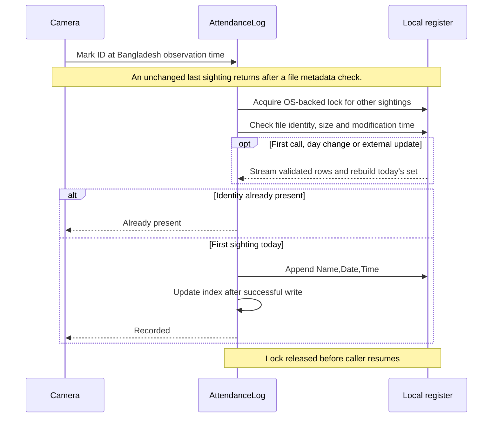

# Engineering review

The baseline places enrollment, camera I/O, matching, CSV persistence and menu handling in one script. An organizer can keep a local gallery, recognize a participant, record the first sighting each day and read the register. The upgrade preserves that workflow and file format. [Reviewed source at 16c7948](https://github.com/pial-paul/iDetectFace/blob/16c7948ca53ecef126f7442c686f0a50766a2361/opencv_attendance.py)

## Findings and changes

| Original behavior | Change in this version | Why it matters |
| --- | --- | --- |
| Every recognized observation opens the CSV and scans from the header. Two processes can both finish the scan before either writes. | Index the current day's identities in memory. Check the file version, refresh when needed, and append under one interprocess lock. | Repeat sightings avoid parsing historical rows. Cooperating processes agree on the first check-in. |
| `compare_faces` and `face_distance` both perform distance work. The display converts the winning distance into a percentage. | Store embeddings in a NumPy matrix, compute one distance vector per detected face and show the nearest distance. | The overlay exposes the quantity the decision actually uses. |
| The old threshold was effectively below 0.5: a candidate had to pass both tolerance 0.6 and `1 - distance > 0.5`. Unknown detections never reached the overlay. | Use a single strict threshold, defaulting to 0.5. Draw rejected faces and omit them from the register. | Operators can distinguish a face that failed matching from an empty frame. |
| A group photo can enter the gallery under one filename. The enrollment prompt can produce an unsafe path or replace an existing image. | Require one detected face, validate filenames, check identity collisions across extensions, and publish a completed JPEG by renaming a temporary file. | The operator can retry a failed capture without relabeling a different person. |
| Exceptions between camera open and normal exit can leave the device held. Reports assume a third column exists after checking for two. | Release capture in a context manager. Validate CSV headers, dates, times and field counts before appending. | A bad row produces an actionable error and the original file remains available for inspection. |
| The README launches a missing script, promises a screenshot, and refers to a license file absent from the tree. The repository tracks portraits and attendance. | Document the real commands, illustrate the data path and measured performance, and exclude runtime data from the current Git tree. | Reviewers can reproduce the example with synthetic data. The repository now includes the MIT license previously declared by its author. |

## Code map

| Component | Responsibility |
| --- | --- |
| [Command line and menu](../idetectface/cli.py) | Parse camera and policy settings, run enrollment or recognition, report by date and surface operational errors. Reporting loads no vision models. |
| [Vision pipeline](../idetectface/vision.py) | Load the gallery once per live session, acquire frames, convert BGR to RGB, call the detector and encoder, match, and draw feedback. |
| [Identity rules](../idetectface/identity.py) | Generate portable enrollment filenames and normalize identity keys for comparisons. |
| [Attendance register](../idetectface/attendance.py) | Validate existing data, maintain the daily index, serialize updates and read reports. |
| [Tests](../tests) | Exercise the register with temporary files, check process concurrency, run the native detector on a synthetic frame and drive the live loop with controlled camera input. |

## How duplicate prevention works

The lock coordinates app instances using the same local file. Reports and all possible writes acquire it with a five-second timeout. An exact repeat of the last committed identity can return after verifying the day and file version. Keep external editors closed during capture. The app checks for file changes between marks. Back up the CSV before manual corrections and reopen the session afterward. Writes are encoded before modifying the file, synced before acknowledgement and truncated back on a recoverable write failure. A hard power loss can still interrupt an append. If validation fails, inspect and repair a copy before replacing the live register.

For **G** gallery images, one face requires **G** embedding distances of dimension 128. Downscaling halves each image dimension and frame skipping reduces detector calls. Both choices can hurt detection of small or briefly visible faces. For **H** history rows, loading or refreshing the daily index takes **O(H)** work. A warm membership lookup takes expected **O(1)**. The last-confirmed identity needs one metadata check. Other identities require the lock. The index holds only that day's distinct identities. All-history reports load the result set in memory.

## Run and maintain a pilot

New check-ins and the “today” report use Asia/Dhaka. Older desktop CSV files have no timezone metadata, so their saved timestamps are read as written.

1. Use a private local data folder. Ask each participant to opt in and assign a unique ID. Names that differ only in case or normalized whitespace refer to one identity. A local account with write access can alter both portraits and attendance.
2. For migration, back up existing files privately before switching branches. Run `records --all` against the chosen data directory and compare totals and timestamps with the original CSV. Re-enroll any gallery image reported as corrupt or containing zero or multiple faces. Legacy CSVs use UTF-8 or the host's default text encoding. Convert a copy to UTF-8 when moving a legacy register between code pages.
3. A camera-open error calls for checking OS camera permissions, closing other capture apps, and trying another `--camera` index. A HighGUI error usually calls for a fresh virtual environment with the desktop OpenCV wheel. The inference adapter locates model data through Python distribution metadata and loads only the detector, five-point landmark predictor and descriptor model.
4. Stop capture before correcting a row or removing a portrait. Keep the minimum necessary data, cover backup copies in the retention plan, and restart capture after changing the gallery. Application-level authentication, encryption and verification of physical presence would require additional controls.
5. Complete the [physical-camera and held-out evaluation](evaluation.md) before making a pilot accuracy claim. For multiple locations, first measure gallery size, concurrent write rate and report latency. If local files become a bottleneck, introduce a database with a unique constraint on participant ID and Bangladesh date, then test imports against existing registers.

The local file design fits a supervised single-workstation prototype. A missing check-in alone cannot establish that someone was absent.
